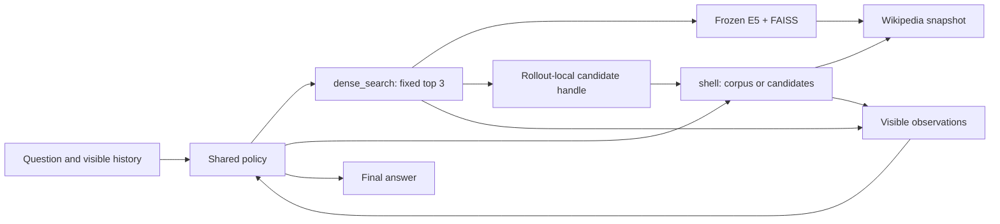

# HiSearch

**Hybrid retrieval agents with multi-trajectory SFT and rubric-based reinforcement learning.**

[中文说明](README.zh-CN.md) · [Retrieval setup](retrieval/README.md) · [SFT](sft/README.md) · [Rubric RL](docs/rubric_rl.md) · [Release status](docs/release_status.md)

HiSearch trains one policy to choose retrieval tools, queries, search scopes,
tool order, and when to answer. It combines dense semantic retrieval with direct
shell search over the same Wikipedia snapshot, then trains the policy using
supervised trajectories and GSPO with optional maintained process rubrics.

This is a source release built on [GrepSeek](https://github.com/alirezasalemi7/grepseek)
and a locally modified, vendored [verl](https://github.com/volcengine/verl).
The Python integration package keeps the name `grepseek` for compatibility.
Model weights, Wikipedia passages, FAISS indexes, generated training examples,
and experiment logs are downloaded or generated separately.

## Architecture



| Tool | Behavior |
| --- | --- |
| `dense_search(query)` | Retrieves exactly three passages using a frozen E5 encoder and FAISS index. The policy cannot set `k`. |
| `shell(command, scope={"type":"corpus"})` | Executes supported shell searches and pipelines over the raw corpus. Omitting `scope` selects the corpus. |
| `shell(command, scope={"type":"candidates","candidate_set_id":"…"})` | Searches or rereads the original JSONL bytes of a previously retrieved candidate set. This is a scope of `shell`. |

Candidate handles belong to one rollout and are cleaned up on completion or
failure. Dense and shell results are checked against the same corpus snapshot.
Candidate-local empty results do not imply corpus-wide absence, and rereading a
candidate can expose text that was truncated in an earlier observation.

The policy has no separate routing model and no required tool mixture. Dense
and shell use separate execution pools; full-corpus shell search supports
line-aligned sharding, request coalescing, bounded caches, output limits, and
timeouts. The dense service supports request batching and parallel GPU shards.

## Training pipeline

1. **Generate and audit SFT trajectories.** A teacher executes real tools using
   free-choice, dense-first, shell-first, shell-only, and dense-only sampling.
   Question grouping keeps trajectories from the same question in the same
   split. Answer matching, visible-evidence checks, chronological leakage checks,
   and observation ablations filter examples. Review is still needed: automated
   checks do not establish that every entity or factual assertion is grounded.
2. **Supervised fine-tuning.** Train the policy on the selected messages and both
   tool schemas. Tool observations are context; assistant responses provide the
   supervised targets.
3. **Outcome-only or rubric-based GSPO.** Use GRPO group advantages and the GSPO
   sequence-level policy loss. The retriever stays frozen and tool observations
   are excluded from the policy loss. Optional rubric scores augment the terminal
   reward; they do not introduce a new optimizer or policy loss.

For a valid trajectory, the rubric reward is exactly:

```text
reward = answer_token_F1 + 0.1 × number_of_passed_rubrics
       ∈ [0, 1.5]                         # five criteria
```

Invalid or failed answers follow the selected baseline's handling and receive
no rubric bonus. Technical judge failures fall back to outcome rewards for the
question group. Uncertain or inapplicable criteria are masked consistently
within that group. Five criteria remain fixed throughout an outer step and all
its refill batches. After the actor update, maintenance may retain the current
version or publish at most one checked revision for the next step. See
[the rubric protocol](docs/rubric_rl.md) for calibration, evidence, and resume
requirements.

**Implementation status:** hybrid SFT and outcome-only RL have historical runs.
The dynamic-rubric path has CPU/mock integration tests; real judge calibration,
rubric RL training gains, and matched ablations remain unverified. The bundled
initial criteria are explicitly human-authored bootstrap templates. This source
release does not claim new benchmark scores or a released checkpoint.

## Quick start: offline rubric checks

Linux and Python 3.10+ are sufficient for the lightweight workflow; these
commands need no GPU, corpus, model server, or training data:

```bash
git clone https://github.com/gxingyu/hisearch.git
cd hisearch
python3 -m venv .venv
source .venv/bin/activate
python -m pip install -r requirements-offline.txt
export PYTHONPATH="$PWD:$PWD/rl:$PWD/verl:${PYTHONPATH:-}"

bash run_gspo_hybrid_rubric.sh --check-only
python -m unittest rl.tests.test_rubric_workflow \
  rl.tests.test_rubric_launcher rl.tests.test_rubric_cli -v
```

`--check-only` without a reference panel reports that dynamic publication is
not ready. Only explicit `--train` invokes the rubric training launcher.
`--self-test` additionally runs trainer integration tests and requires the full
[training environment](TRAINING_ENV.md).

## Prepare retrieval and training inputs

The GPU pipeline uses separate environments for policy training and dense
retrieval. Install the policy stack with the ordered recipe in
[TRAINING_ENV.md](TRAINING_ENV.md), and prepare the raw corpus, frozen E5 model,
index, offsets, and Search-R1 encoder dependency using
[retrieval/README.md](retrieval/README.md). Large resources are not in Git.

RL JSONL contains one question per line:

```json
{"id":"train-example","question":"Which city is the capital of France?","golden_answers":["Paris"],"source":"example"}
```

Build NQ + HotpotQA training inputs using the public dataset loader:

```bash
python rl/prepare_rl_data.py --out_dir data/rl/nq_hotpot
# Optional: build the seven-benchmark validation mix from local FlashRAG files.
python rl/prepare_flashrag_val.py --dataset-root data/flashrag_datasets \
  --output data/rl/flashrag_7bench/val.jsonl
```

The second command requires the source validation files described in
[rl/README.md](rl/README.md). Alternatively, set `GREPSEEK_VAL_FILES` to the
generated `data/rl/nq_hotpot/dev.jsonl`; these validation protocols differ.

## Run SFT

Configure an OpenAI-compatible teacher endpoint with `LLM_BASE_URL`, `LLM_MODEL`,
and `OPENAI_API_KEY` in your environment. With retrieval running:

```bash
python sft/data_generation/create_hybrid_data.py \
  --tokenizer models/base --dataset hotpotqa --split train --n 200 \
  --out-dir outputs/hybrid_sft
python sft/data_generation/to_parquet.py \
  --in outputs/hybrid_sft/sft.jsonl --out_dir data/sft/parquet --include_tools

MODEL_PATH="$PWD/models/base" DATA_DIR="$PWD/data/sft/parquet" NPROC=8 \
  bash sft/run_sft_multitrajectory.sh
```

Supply an actual local policy model at `models/base`, or set `MODEL_PATH` and
`--tokenizer` explicitly. Synthesis and training do not run automatically.
[sft/README.md](sft/README.md) explains checkpoint merging and export details.

## Run GSPO

Point the launchers at a local merged SFT checkpoint and your data:

```bash
export PYTHONPATH="$PWD:$PWD/rl:$PWD/verl:${PYTHONPATH:-}"
export GREPSEEK_MODEL_PATH="$PWD/models/sft"
export GREPSEEK_TRAIN_FILES="$PWD/data/rl/nq_hotpot/train.jsonl"
export GREPSEEK_VAL_FILES="$PWD/data/rl/nq_hotpot/dev.jsonl"
export GREPSEEK_CORPUS_ROOT="$PWD/data/wiki_18_corpus"
export GREPSEEK_DENSE_DATA_ROOT="$PWD/data/search_r1"
export GREPSEEK_DENSE_URL=http://127.0.0.1:8000/retrieve
export CUDA_VISIBLE_DEVICES=0,1,2,3,4,5,6,7
export NPROC=8

bash run_gspo_hybrid.sh --check-only
# Starts outcome-only policy training, with retrieval preflight:
bash run_gspo_hybrid.sh trainer.val_before_train=true
```

The baseline launcher defaults to 200 outer updates, 256 retained question
groups, five rollouts per question, and checkpoint/validation intervals of 40.
Dynamic filtering may require more than `256 × 5` sampled trajectories per
update. All-sampled statistics, retained training batches, independent validation,
and saved checkpoints have different meanings.

For rubric RL, first prepare an initial version and an independent training-only
reference panel with [docs/rubric_rl.md](docs/rubric_rl.md), then run:

```bash
export GREPSEEK_RUBRIC_INITIAL_PATH=/absolute/path/to/initial.json
export GREPSEEK_RUBRIC_CALIBRATION_PATH=/absolute/path/to/reference.jsonl
export GREPSEEK_RUBRIC_URL=http://127.0.0.1:8100/v1
export GREPSEEK_RUBRIC_MODEL=your-judge-served-name
# Set GREPSEEK_RUBRIC_API_KEY if the endpoint requires authentication.
bash run_gspo_hybrid_rubric.sh --check-only --require-calibration
bash run_gspo_hybrid_rubric.sh --train trainer.val_before_train=true
```

The rubric recipe uses a five-call limit with over-limit requests treated as
invalid. This differs from the original hybrid baseline's default limit behavior;
for an outcome-only ablation with the same protocol, use the configuration in
[rl/README.md](rl/README.md). W&B is optional and enabled only when both
`WANDB_API_KEY` and `WANDB_ENTITY` are supplied by the user.

## Source layout

| Path | Purpose |
| --- | --- |
| `inference/retrieval_env/` | Shared schemas, dense client, candidate sessions, corpus alignment, preflight |
| `inference/parallel_search/` | Sharded shell execution, daemon, caches, process cleanup |
| `retrieval/` | Frozen E5 + FAISS service, downloads, corpus offsets, batching |
| `sft/data_generation/` | Executed teacher trajectories, review, grouped parquet export |
| `sft/run_sft_multitrajectory.sh` | Multi-trajectory SFT launcher |
| `rl/grepseek/trainer/verl_integration/` | Hybrid rollout, dataset, tools, outcome reward |
| `rl/grepseek/rubric/` | Five-criterion scoring, maintenance, statistics, checkpoint state |
| `rl/rubric_workflow.py` | Offline initialization, reference preparation, replay |
| `verl/` | Complete vendored Python runtime with local training fixes |
| `scripts/check_release.py` | Checks tracked files for oversized files, artifacts, and credential patterns |

Some optional historical reward controls remain in the shared runtime because
the trainer imports them. The rubric launcher disables those controls. Obsolete
experiment launchers, machine setup snapshots, notebooks, training artifacts,
and research diaries are excluded from this release.

The legacy `inference/run.py` entry point is shell-only. Hybrid evaluation uses
the training agent loop with `trainer.val_only=true`; see [rl/README.md](rl/README.md).

## License and attribution

Code is distributed under [Apache-2.0](LICENSE), with upstream notices retained.
See [NOTICE](NOTICE), [third-party attribution](docs/PROVENANCE.md), and
[the vendored runtime notes](verl/VENDORED.md). Models and datasets retain their
own licenses. Paper metadata and released model/data links can be added when
available; no paper title, DOI, or benchmark claim is invented for this release.
